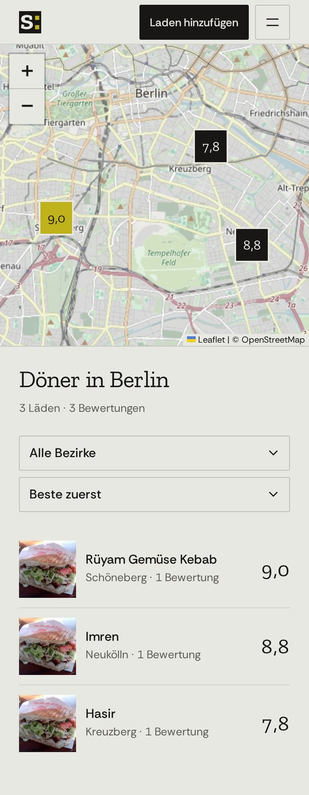

# spießgesell:innen

A few friends and I meet up for döner around Berlin and argue about which place is best. This is the site we use to keep score.

<p align="center">
  
  
</p>

## What it does

- Add a shop by pasting a Google Maps link. The name, street and district come from the link, and you can correct them before saving.
- Each review has a visit date, five 1–10 scores, optional text and price, and up to six photos. Photos are converted to WebP and stripped of EXIF data.
- The map and ranking update from the reviews. The ranking shows the best overall and per category.
- Everyone uses the same password and picks a name. That name is the only ownership check, so anyone using it can edit or delete its reviews.

## Run it

```sh
cp .env.example .env
# set SECRET_KEY and SHARED_PASSWORD
docker compose pull
docker compose up -d
```

The published image is `ghcr.io/tswh0/spiessgesell-innen`. It is private, so run `docker login ghcr.io` with a token that has `read:packages` before pulling. Set `IMAGE_TAG` in `.env` to pin a release instead of `latest`.

The app listens on `127.0.0.1:8095`. Put Caddy or a tunnel in front; `Caddyfile.snippet` has the two lines for `doner.twh0.de`. To build the image from source instead:

```sh
docker compose up -d --build
```

Data lives in the `data` volume. Back it up with:

```sh
docker run --rm -v spiessgesell-innen_data:/data -v "$PWD":/backup alpine tar czf /backup/data.tgz -C /data .
```

## Local development

```sh
uv venv .venv && . .venv/bin/activate
uv pip install -r requirements.txt -r requirements-dev.txt
cp .env.example .env
export $(grep -v '^#' .env | xargs)
python scripts/seed.py
uvicorn app.main:app --reload --port 8090
```

Run `pytest` for the tests. The seed script adds three Berlin shops; `scripts/reset.py` clears reviews or shops.

## Notes

- SQLite and uploads sit in one volume. Map tiles, fonts and reverse geocoding come from public services; there are no API keys.
- The PWA installs from the browser and keeps working offline.
- GitHub Actions builds a multi-arch image on every published release. Tags follow `v1.0.0`, `1.0.0`, `1.0` and `latest`.
